# Cine App: simulacro resuelto de la T1

[](https://github.com/marlonpya/CineApp/actions/workflows/compilar.yml)

Simulacro de la **primera evaluación (T1)** del curso *Desarrollo de Aplicaciones Móviles II* (CIBERTEC). El examen real tiene **la misma estructura, la misma rúbrica y la misma dificultad**; solo cambia el tema (otra app, otros datos, otros rangos).

## Cómo usar este simulacro

1. **Lee el enunciado:** [simulacro/Simulacro_T1_CineApp.pdf](simulacro/Simulacro_T1_CineApp.pdf).
2. **Resuélvelo tú solo**, en Xcode, como si fuera el examen. Intenta hacerlo en el tiempo del examen.
3. **Compara** con la solución explicada: [simulacro/Simulacro_T1_CineApp_resuelto.pdf](simulacro/Simulacro_T1_CineApp_resuelto.pdf). Ahí está el código de cada pregunta, el porqué de cada decisión, la rúbrica con lo que se revisa y una guía práctica de Xcode.
4. **Prepara la sustentación oral** con [SUSTENTACION.md](SUSTENTACION.md): en el examen tendrás que explicar tu código.

> Copiar este proyecto no te prepara para el examen: el tema será distinto y tendrás que explicar cada línea. Úsalo para entender el patrón.

## Cómo abrir y ejecutar el proyecto

1. Descarga el repositorio: botón verde **Code → Download ZIP** (o `git clone https://github.com/marlonpya/CineApp.git`).
2. Abre `CineApp.xcodeproj` con **Xcode 16 o posterior**.
3. Elige un simulador de iPhone en la barra superior y presiona **⌘R**.

El distintivo «Compilar» de arriba indica que el proyecto compila en una Mac de GitHub con la versión actual de Xcode.

## Qué temas usa

Solo lo visto en clase: **SwiftUI**, **`@State`** y **`@Binding`** (sin ViewModel), **`List`** con **`.swipeActions`**, **`Form`** con **`TextField`**, **`NavigationStack`**, **`NavigationLink`** y **`dismiss`**.

## Flujo de la app

```
Bienvenida ──(botón Ingresar)──▶ Cartelera ──(botón +)──▶ Registro
                                     ▲                        │
                                     └──── Guardar (dismiss) ─┘
```

Desde la Cartelera no se puede regresar a la Bienvenida.

## Cómo se ve la app

Capturas reales de este proyecto ejecutándose en un simulador de iPhone 16. Se generan automáticamente con un recorrido de prueba que pasa por cada pantalla y cada caso.

### Pantallas

<table>
<tr>
<td align="center" valign="top">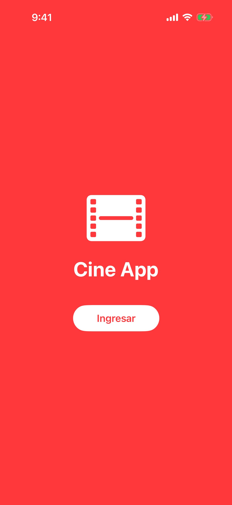<br><b>1. Bienvenida</b><br><sub>P01: fondo rojo, ícono, texto y botón</sub></td>
<td align="center" valign="top">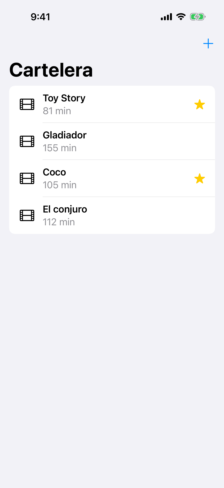<br><b>2. Cartelera</b><br><sub>P02: 4 películas, estrella en favoritas</sub></td>
<td align="center" valign="top">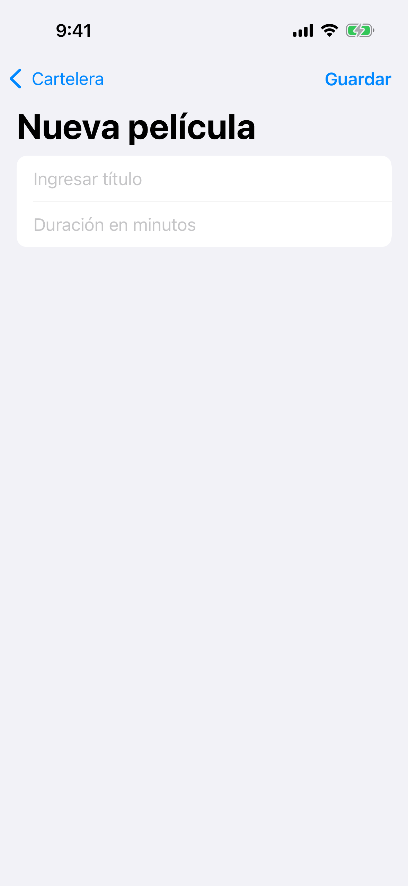<br><b>3. Registro</b><br><sub>P04: título, duración y Guardar</sub></td>
</tr>
</table>

### Favoritos con swipe (P03)

<table>
<tr>
<td align="center" valign="top">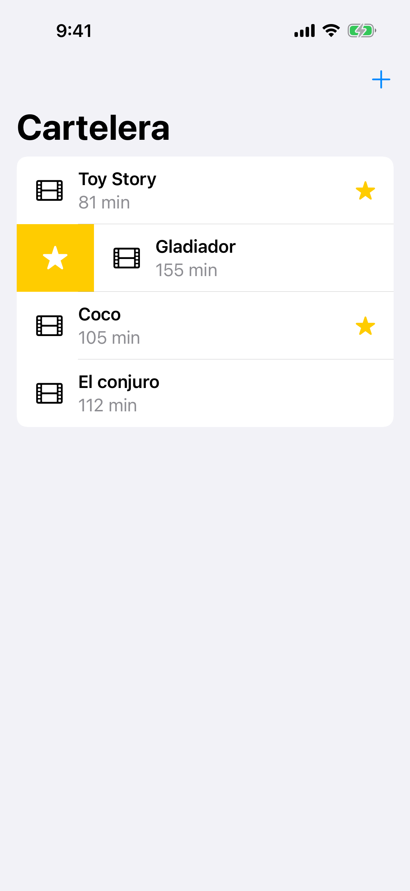<br><b>Deslizar «Gladiador»</b><br><sub>No es favorita: botón amarillo</sub></td>
<td align="center" valign="top">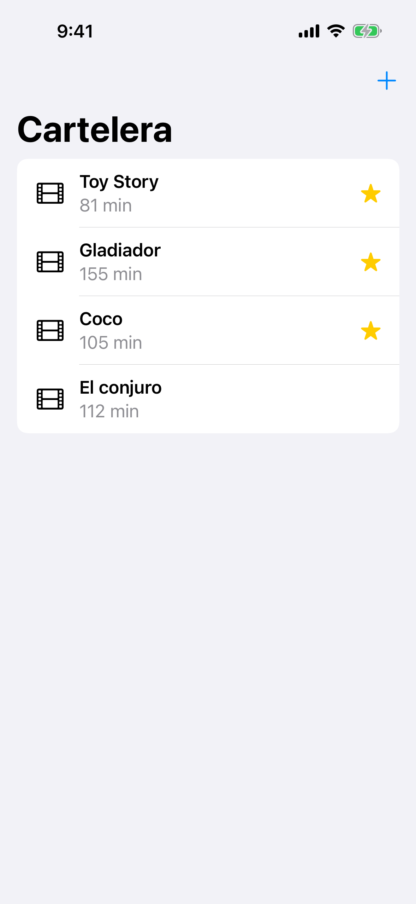<br><b>Después de tocarlo</b><br><sub>Aparece la estrella</sub></td>
<td align="center" valign="top">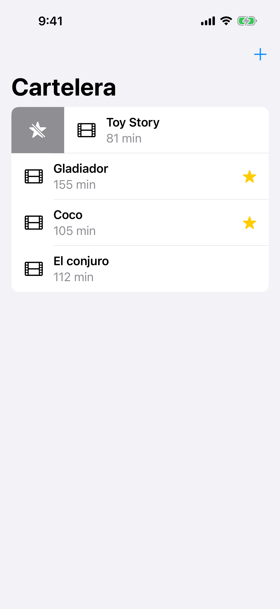<br><b>Deslizar «Toy Story»</b><br><sub>Ya es favorita: botón gris para quitar</sub></td>
</tr>
</table>

> En iOS, un botón de swipe con texto e ícono (`Button("Favorito", systemImage: "star")`) muestra **solo el ícono**. El texto «Favorito» o «Quitar» queda como nombre del botón para la accesibilidad; no es un error.

### Casos de validación (P04)

<table>
<tr>
<td align="center" valign="top">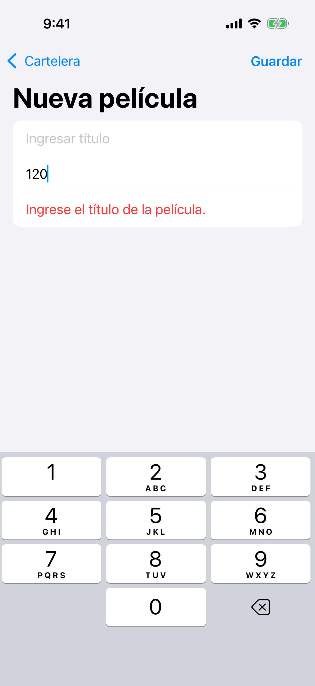<br><b>Regla 1</b><br><sub>Título vacío, duración 120</sub></td>
<td align="center" valign="top"><br><b>Regla 2</b><br><sub>Título «Coco», duración vacía</sub></td>
</tr>
</table>

<table>
<tr>
<td align="center" valign="top">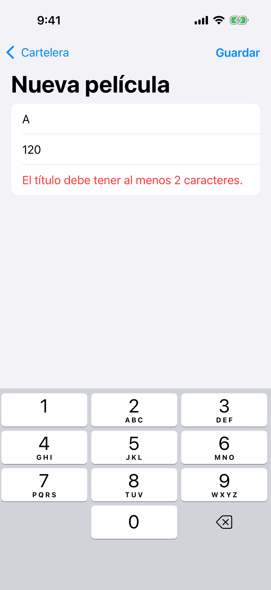<br><b>Regla 3</b><br><sub>Título «A», duración 120</sub></td>
<td align="center" valign="top">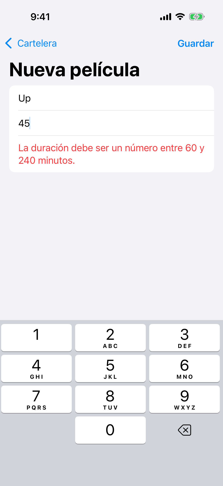<br><b>Regla 4</b><br><sub>Título «Up», duración 45</sub></td>
</tr>
</table>

### Datos válidos (P04 y P05)

<table>
<tr>
<td align="center" valign="top">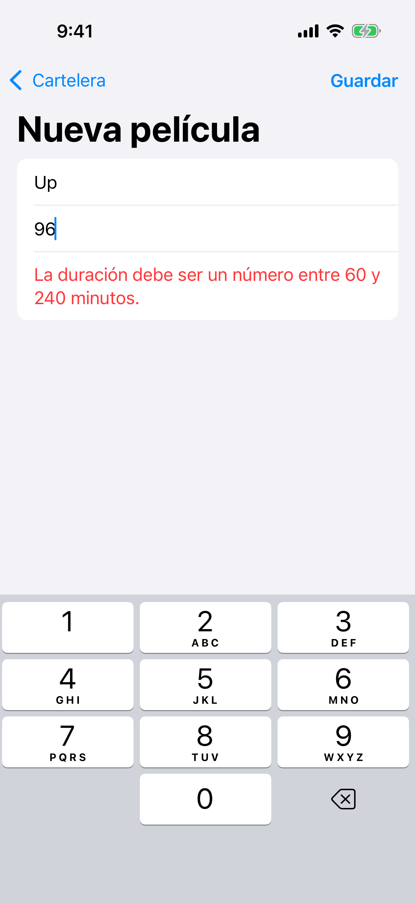<br><b>Antes de Guardar</b><br><sub>Título «Up», duración 96</sub></td>
<td align="center" valign="top">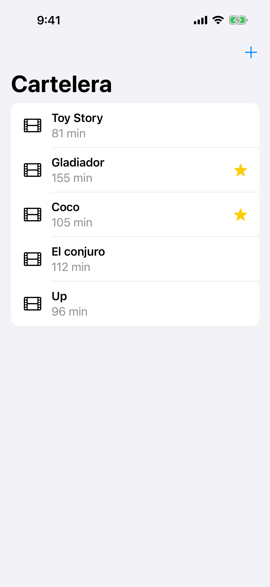<br><b>Después de Guardar</b><br><sub>Vuelve a la Cartelera con «Up» al final</sub></td>
</tr>
</table>


## Archivos

```
CineApp/
├── CineAppApp.swift          punto de entrada (sin cambios)
├── ContentView.swift         Bienvenida o Cartelera (if/else con @State)
├── Modelo/
│   └── Pelicula.swift        struct Pelicula + 4 películas de ejemplo
└── Vistas/
    ├── BienvenidaView.swift  Pregunta 01: maquetado y botón Ingresar
    ├── CarteleraView.swift   Preguntas 02 y 03: lista, swipe de favoritos y botón +
    ├── FilaPelicula.swift    una fila de la lista
    └── RegistroView.swift    Preguntas 04 y 05: formulario, validaciones y dismiss
```

## Validaciones del Registro

Se revisan en este orden y se muestra en rojo el mensaje de la primera que falla:

| # | Regla | Mensaje |
|---|---|---|
| 1 | Título vacío | «Ingrese el título de la película.» |
| 2 | Duración vacía | «Ingrese la duración de la película.» |
| 3 | Título con menos de 2 caracteres | «El título debe tener al menos 2 caracteres.» |
| 4 | Duración no numérica o fuera de 60 a 240 | «La duración debe ser un número entre 60 y 240 minutos.» |
